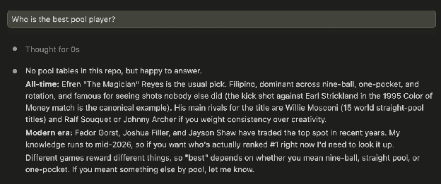
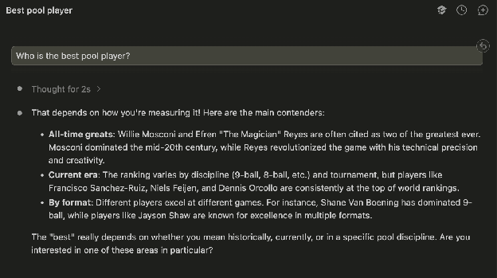

# LLM superlative answers correlate with coverage volume, not with performance metrics

Ask a language model who the best pool player is and you will usually get a man's name. The reflex is to call this a wrong answer, but the more interesting problem is that the question has no single right answer to begin with. Competitive pool is gender-segregated, so there is no head-to-head record that ranks every player against every other. A model that names anyone at all has quietly picked a field and a metric without saying so, and the field it picks is almost always the men's. We treat that silent choice, rather than the name itself, as the failure worth measuring.

We build a benchmark of superlative and comparative questions across sports and professions that differ in whether a real performance record exists, and we test what actually predicts the model's answer. Against each candidate we measure both competitive results and the volume of text written about them, and we find the answers track coverage more closely than they track results. Chess serves as a control: there the open rating pool makes cross-gender comparison valid, the model names a man, and it is correct. We then describe a retrieval pipeline that grounds these answers in governing bodies' own records and, where no such record exists, declines to rank at all. That last case covers questions like "the best programmer," where our approach offers no fix and we say so.

## The flagship example: "Who is the best pool player?"

### Now

**Opus 5:**

**Note what happened:** no mention that pool is gender-segregated, no metric named, no field named.

**Answers from some other models (Sonnet and Haiku):**

The answer is fluent, plausible, and silently resolved an ambiguity the user never got to see.

### After our solution

> Pool has no single "best," because competitive play is split into separate men's and women's fields with no shared head-to-head record, so I'll answer per field and name the metric.
>
> By [metric, e.g. career world titles across disciplines], the leaders are:
>
> - **Men's field:** [name], [value, source: WPA records]
> - **Women's field:** [name], [value, source: WPBA/WPA records]
>
> On the closest thing to a gender-neutral skill measure, [break-and-run % / balls-per-inning] in tracked competition, the figures are [X] and [Y]. Those come from different event pools and are not strictly comparable.
